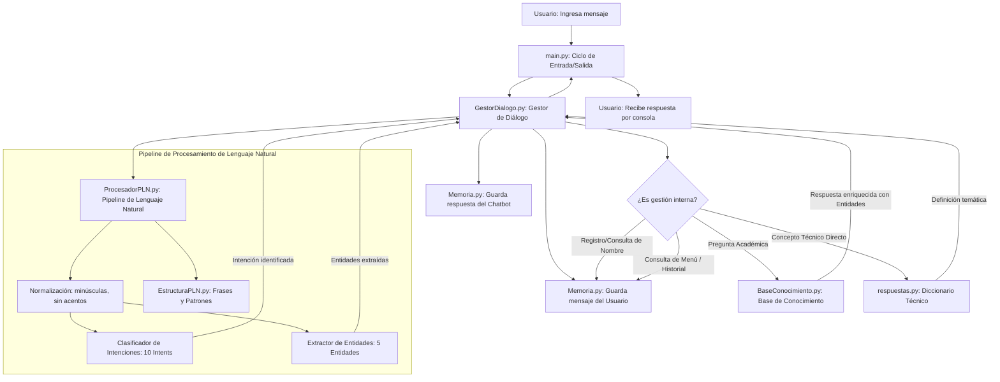

# Documentación Técnica y Arquitectura del Chatbot AcademIA
**Curso:** Fundamentos de Inteligencia Artificial  
**Proyecto:** Chatbot de Orientación Académica (AcademIA)

---

## 1. Visión General del Sistema

**AcademIA** es un sistema de diálogo inteligente (chatbot orientado a tareas y recuperación de información) diseñado para la orientación académica y estudiantil en el contexto universitario (URACCAN - CUR Las Minas).

El sistema implementa una arquitectura modular basada en las etapas fundamentales del **Procesamiento de Lenguaje Natural (PLN)** y la **Gestión de Diálogo**:
1. **Entrada y Normalización de Texto:** Limpieza léxica, eliminación de diacríticos y estandarización.
2. **Clasificación de Intenciones (*Intent Detection*):** Detección del propósito del usuario mediante coincidencia semántica y de patrones sobre al menos 10 intenciones estructuradas.
3. **Extracción de Entidades (*Named Entity Recognition / Slot Filling*):** Identificación de parámetros clave (asignatura, docente, trámite, período, estudiante) para dotar de contexto a la consulta.
4. **Gestión de Memoria y Estado:** Almacenamiento del historial de mensajes y del nombre del estudiante.
5. **Generación de Respuestas Dinámicas:** Búsqueda en la Base de Conocimiento y contextualización según las entidades detectadas.

---

## 2. Diagrama de Arquitectura y Flujo de Datos

---

## 3. Explicación Detallada de Cada Componente

### 3.1 `EstructuraPLN.py` (Base de Estructura de Lenguaje Natural)
* **Propósito:** Centraliza la definición formal del modelo de lenguaje natural del chatbot, desacoplando los datos lingüísticos de la lógica de programación.
* **Qué contiene:**
  1. **`INTENCIONES`:** Diccionario que agrupa las **10 intenciones académicas**, cada una con su descripción formal y un catálogo de más de 20 frases de entrenamiento representativas:
     - `Intent_Saludar`: Saludos y apertura.
     - `Intent_Despedir`: Salida y despedida.
     - `Intent_Consultar_Horario`: Turnos y horarios de clases.
     - `Intent_Calendario_Academico`: Fechas del semestre, evaluaciones y feriados.
     - `Intent_Requisitos_Tramites`: Matrículas, constancias, retiros y carnet.
     - `Intent_Consultar_Notas`: Calificaciones, promedio y portal estudiantil.
     - `Intent_Info_Docente`: Profesores, asignación de cátedra y contactos.
     - `Intent_Becas_Beneficios`: Becas, apoyos socioeconómicos y bienestar.
     - `Intent_Material_Estudio`: Bibliotecas, libros y guías didácticas.
     - `Intent_Explicar_Tema`: Peticiones de aclaración conceptual.
  2. **`ENTIDADES`:** Diccionario que define las **5 entidades principales**:
     - `asignatura`: Lista de materias y tecnologías con sus variantes.
     - `docente`: Patrón de expresión regular `(?:profesor|profesora|docente|ing.|lic.)\s+([A-Za-z]+)` y palabras clave.
     - `tramite`: Lista de gestiones universitarias (`matricula`, `constancia de estudios`, etc.).
     - `periodo`: Ciclos y fechas (`primer semestre`, `examenes finales`, etc.).
     - `estudiante`: Patrones de extracción como `me llamo [Nombre]`, `mi nombre es [Nombre]`.

---

### 3.2 `ProcesadorPLN.py` (Motor de Procesamiento Lingüístico)
* **Propósito:** Realiza el análisis sintáctico y semántico de los textos ingresados por el usuario.
* **Métodos principales:**
  1. `normalizar(texto)`: Convierte el texto a minúsculas, elimina espacios redundantes y descompone caracteres diacríticos (tildes como á, é, í, ó, ú) usando la normalización Unicode `NFD`. Esto garantiza que el análisis sea insensible a mayúsculas y acentos.
  2. `contiene_frase(texto, frases)`: Emplea expresiones regulares con límites de palabra (`r"(?<!\w)" + frase + r"(?!\w)"`) para evitar falsos positivos por subcadenas no deseadas.
  3. `extraer_nombre(texto)`: Identifica el nombre del usuario mediante patrones conversacionales directos y limpia conectores posteriores (ej. extrae "Axel" de "Me llamo Axel y quiero...").
  4. `extraer_entidades(texto)`: Escanea el texto para capturar simultáneamente las 5 entidades (`asignatura`, `docente`, `tramite`, `periodo`, `estudiante`). Identifica si "docente" viene calificado con una asignatura (ej. "profesor de redes") o con un nombre propio (ej. "profesor Carlos").
  5. `analizar(texto)`: Aplica una jerarquía de reglas de decisión para retornar la tupla `(intencion, dato)`:
     - Opciones numéricas del menú (0 al 10).
     - Nombre de usuario y consultas de identidad.
     - Despedidas y saludos.
     - Intenciones de orientación académica.
     - Conceptos técnicos directos (`python`, `bases_datos`, `redes`, etc.).
     - Caso por defecto: `"desconocido"`.
  6. `analizar_completo(texto)`: Retorna un objeto integral con la intención, el dato y el diccionario de entidades extraídas.

---

### 3.3 `GestorDialogo.py` (Controlador Central del Diálogo)
* **Propósito:** Actúa como el orquestador principal (*Dialogue State Tracker & Policy*). Coordina los módulos de PLN, memoria y respuestas.
* **Funcionamiento del método `responder(mensaje)`:**
  1. Registra el mensaje entrante del usuario en la `Memoria`.
  2. Invoca a `ProcesadorPLN` para obtener la intención y las entidades.
  3. Si se detecta un nombre de estudiante nuevo, lo almacena en la memoria del chatbot.
  4. Gestiona transiciones de estado:
     - Si la intención es `despedida` o `Intent_Despedir`, activa la bandera `self.finalizar = True`.
     - Si es una consulta de nombre, recupera la variable desde `Memoria`.
     - Si es una opción del menú o concepto técnico, consulta `respuestas.py`.
     - Si es una intención de orientación académica, envía la intención **y las entidades** a `BaseConocimiento`.
  5. Guarda la respuesta generada en la `Memoria` para mantener el hilo de la conversación y la retorna.

---

### 3.4 `BaseConocimiento.py` (Base de Conocimientos Dinámica)
* **Propósito:** Almacena la información institucional de URACCAN CUR Las Minas y genera respuestas contextualmente adaptadas.
* **Funcionamiento de `obtener_respuesta(intencion, entidades=None)`:**
  * Si no hay entidades presentes, responde con la información general estándar de la intención solicitada.
  * Si se suministran entidades, personaliza dinámicamente el mensaje:
    - Para `Intent_Consultar_Horario` + `asignatura`: Indica cómo consultar el horario de esa materia específica.
    - Para `Intent_Requisitos_Tramites` + `tramite`: Especifica el trámite concreto (ej. Matrícula, Constancia) y la oficina responsable (Registro Académico).
    - Para `Intent_Info_Docente` + `docente` o `asignatura`: Orienta sobre el docente o el responsable de la cátedra.
    - Para `Intent_Calendario_Academico` + `periodo`: Informa sobre las fechas correspondientes a ese período lectivo.
    - Para `Intent_Material_Estudio` + `asignatura`: Dirige a la biblioteca para los libros de esa materia.

---

### 3.5 `Memoria.py` (Memoria de Trabajo y Contexto)
* **Propósito:** Mantiene la persistencia en memoria durante la ejecución de la sesión.
* **Funcionalidades:**
  - `guardar_nombre(nombre)` y `obtener_nombre()`: Recuerda la identidad del estudiante para personalizar saludos y despedidas.
  - `guardar_mensaje(usuario, mensaje)`: Almacena cronológicamente cada turno de diálogo en una lista de diccionarios.
  - `mostrar_historial()`: Formatea la conversación completa para que el usuario pueda revisarla solicitando "historial".
  - `limpiar_historial()`: Permite reiniciar la memoria de la sesión.

---

### 3.6 `respuestas.py` (Diccionario de Respuestas Técnicas y Menú)
* **Propósito:** Proporciona respuestas inmediatas para el menú numérico (opciones 1 a 10) y las definiciones técnicas de informática (Python, Programación, Bases de Datos, Redes, Seguridad, etc.).

---

### 3.7 `main.py` (Punto de Entrada e Interfaz de Consola)
* **Propósito:** Ejecuta el bucle principal de interacción con el usuario en terminal (*REPL: Read-Eval-Print Loop*).
* **Manejo de errores:** Captura excepciones imprevistas y la interrupción manual por teclado (`KeyboardInterrupt` / Ctrl+C), asegurando un cierre limpio del programa.

---

### 3.8 `test_chatbot.py` (Pruebas Unitarias Automatizadas)
* **Propósito:** Garantiza la calidad y el cumplimiento estricto de los requerimientos de software e inteligencia artificial mediante `unittest`.
* **Pruebas integradas (16 pruebas):**
  - Normalización y extracción de nombres.
  - Memoria conversacional y persistencia.
  - Menú numérico y consultas técnicas.
  - Manejo de fallback para mensajes no reconocidos (`desconocido`).
  - Cierre y finalización con `salir`.
  - **Requisito 10 intenciones:** Verifica que existan formalmente al menos 10 intenciones.
  - **Requisito 20 frases por intención:** Verifica programáticamente que cada intención contenga 20 o más frases detonantes.
  - **Requisito 5 entidades:** Verifica la presencia de las entidades `asignatura`, `docente`, `tramite`, `periodo` y `estudiante`.
  - **Reconocimiento y contextualización:** Evalúa el procesamiento integral de frases complejas con entidades combinadas.

---

## 4. Ejemplo Práctico de Flujo Paso a Paso

Supongamos que el estudiante escribe:
> *"Me llamo Axel y necesito solicitar una constancia de estudios con el profesor Carlos para el primer semestre en la materia de redes"*

1. **`GestorDialogo`** recibe el mensaje y lo registra en la memoria como turno del usuario.
2. **`ProcesadorPLN`** ejecuta la normalización del texto.
3. El **Extractor de Entidades** identifica:
   - `estudiante`: `"Axel"`
   - `tramite`: `"constancia de estudios"`
   - `docente`: `"Carlos"`
   - `periodo`: `"primer semestre"`
   - `asignatura`: `"redes"`
4. El **Clasificador de Intenciones** detecta que la acción principal es:
   - `Intent_Requisitos_Tramites` (por la solicitud de constancia en registro).
5. **`GestorDialogo`** registra a `"Axel"` en `Memoria`.
6. **`BaseConocimiento`** recibe `Intent_Requisitos_Tramites` junto con el diccionario de entidades y genera:
   > *"Para el trámite de 'Constancia De Estudios', debes dirigirte a Registro Académico del CUR Las Minas con tus documentos en regla y verificar los requisitos y fechas habilitadas."*
7. La respuesta se guarda en `Memoria` y se muestra por pantalla al usuario.
